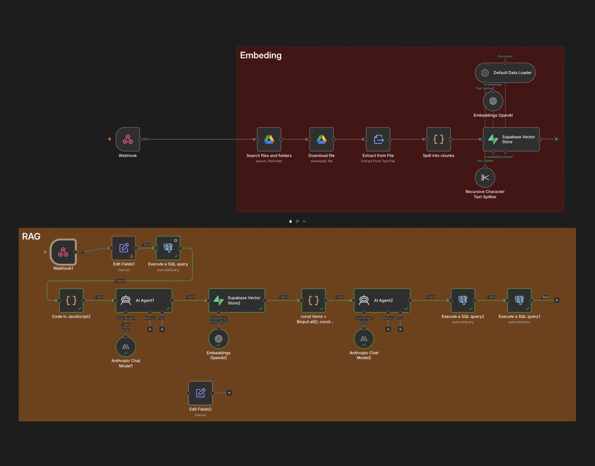

# Sales Knowledge Agent

A question-answering agent for sales reps, built on a company's own documents. It cites every fact, refuses when the answer is not in the documents, and handles follow-up questions in conversation.

Built as a portfolio project. Hirelane is a fictional ATS company; the documents, people and data are invented. See [Test data](#test-data).



---

## The problem

A rep is on a call and needs a number. What does Growth cost. How long is implementation. Does it integrate with their payroll. The answer exists somewhere in a drive folder, in a document last updated eight months ago, next to an older version of the same document that says something different.

Searching for it takes longer than the call allows, so reps guess. Then they quote the wrong price.

## What it does

Two workflows.

**Ingestion** reads the documents from Google Drive, splits each one at its section headings, converts every section to an embedding, and stores it in Supabase with its source file and section name attached. Run once, or again when the documents change.

**The chat agent** answers one question:

1. Fetches the last 6 messages for this user
2. Rewrites the question into a standalone search query using that history
3. Embeds the rewritten query and retrieves the 8 closest document sections
4. Answers from those sections only, citing the file and section for each fact
5. Saves the question and answer


---

## Design decisions

**Split documents at section headings, not at a fixed character count.**
Each `##` block is already a complete thought. Fixed-length chunks cut sentences in half and mix unrelated topics together, which is the most common reason a RAG system returns something irrelevant. Every chunk also carries its document title and section heading inside the embedded text, so a chunk still makes sense when it is retrieved on its own.

**Rewrite the question before searching it.**
This is the piece most RAG examples leave out, and it is what makes conversation work. "What about Enterprise?" contains nothing searchable. Embedded as-is it retrieves noise. The rewrite step turns it into "Enterprise plan pricing per employee" using the conversation history, and that is what gets searched. The conversation history is also given to the answering model, but feeding it to the model alone does not fix retrieval.

**Pass several chunks to the model, not the single best match.**
In testing, the correct document was ranked first for 12 of 14 answerable questions but appeared in the returned set for all 14. The two misses lost by less than 0.02 similarity. Handing over only the top hit would have failed those two.

**Keep conversations out of the vector store.**
Chat messages go in their own table and are never embedded. If they shared a table with the documents, a rep's wrong guess could later be retrieved as a source and cited back as fact. Documents are knowledge; conversations are context.

**Filter history by user before limiting it.**
The `where user_id = ...` runs before `limit 6`, so two reps asking at the same time never consume each other's slots. Turns 3 and 4 of the memory test are the proof: the same question from two users returns two different answers.

**Tell the model what it is allowed to do, then let it refuse.**
The prompt forbids outside knowledge, requires a citation per fact, and instructs it to prefer the most recently updated source when two disagree. When retrieval returns nothing useful, the correct output is "I can't answer this from the documents", not a plausible guess. This is the behaviour that makes the thing usable before a call.

---

## Results

Full detail in [results/test_results.md](results/test_results.md).

| | |
|---|---|
| Retrieval: correct document returned | 14 / 14 answerable questions |
| Answers correct (topK 8) | 16 / 16 |
| Refusals correct | 4 / 4 |
| Conflicting sources handled correctly | 5 / 5 |
| Memory: two users, 8 interleaved turns | 8 / 8 |

**The planted conflict.** The document set contains two pricing documents: the current card and a superseded 2025 one. They are near-identical in meaning, so similarity search retrieves both and cannot tell which is current. In all 5 questions where both were retrieved, the agent gave the current figure as the answer and noted the older terms and who they still apply to.

**The single failure, and why it is worth reading.** At topK 5, one question returned "no current minimum is documented" when the answer was in a table the search did not retrieve. The model answered correctly about what it had been given and told the rep to check before quoting. The failure was in retrieval; the guardrails turned it into a refusal rather than a wrong number. The same thing happened at larger scale when a grouping bug silently misaligned the context: 9 of 16 answers became refusals, and none became fabrications.

---

## Limitations

- **Memory is a fixed window of 6 messages.** A long conversation forgets its own beginning. The fix is to keep recent turns verbatim and summarise older ones, which is what longer-running assistants do.
- **The embedding model cannot tell current from superseded.** Both pricing cards score nearly identically. Only the answering model, reading the dates, resolves it. Filtering on metadata at query time would be the stronger fix.
- **n8n's Default Data Loader re-chunks the input.** The section-based splitting produces 62 chunks; the loader cuts them further and the splitter cannot be fully disabled. The metadata survives, so citations stay correct, but the chunk boundaries are not exactly as designed. Calling the embeddings API directly would give full control.
- **Documents are re-ingested wholesale.** There is no incremental update, so changing one file means clearing the table and reloading everything.
- **No access control.** Every user can retrieve every document. A real deployment would filter by metadata on the user's permissions.
- **14 documents, 62 chunks.** Enough to demonstrate the behaviour, not enough to say anything about performance at scale.

## Next steps

- A chat interface served from n8n, so reps use it without opening the workflow
- Summarise older conversation turns instead of dropping them
- Filter retrieval by metadata, for example excluding superseded documents unless asked for historical terms
- Log unanswered questions, which is a direct list of what the documentation is missing
- Re-ingest automatically when a Drive file changes

---

## Stack

n8n · Supabase (Postgres + pgvector) · OpenAI `text-embedding-3-small` for embeddings · Claude for the rewrite and the answer · Google Drive as the document source

Anthropic does not provide an embedding model, so embeddings and generation come from different providers. This is a common split.

## Repository

```
workflow/    the two n8n workflows, credentials removed
sql/         schema, the similarity search function, the history query
docs/        the 14 fictional Hirelane documents
test-data/   the retrieval and memory test sets
results/     full test results and the failures worth reading
```

## Setup

1. Create a Supabase project and run `sql/00_schema.sql` and `sql/01_match_documents.sql`.
2. Upload the files from `docs/` to a Google Drive folder.
3. Import both workflows into n8n and add credentials: Google Drive, Supabase API, OpenAI, Anthropic, Postgres.
4. In the ingestion workflow, set the Drive folder ID on the **List documents** node.
5. For the Postgres credential use Supabase's session pooler connection details, not the direct connection, which is IPv6-only.
6. Run the ingestion workflow once, then check `select count(*) from documents;`.
7. Run the chat workflow, changing `question` and `user_id` on the **Ask a question** node.

## Test data

`docs/` contains 14 fictional documents written to include three things on purpose: a superseded pricing document that contradicts the current one, three real gaps in the product (no Dutch payroll integration, no SAP SuccessFactors connector, no customer count anywhere), and questions whose answer requires combining two documents.

`test-data/` contains both test sets with their expected sources, so the results can be reproduced.

## Authorship

I designed the chunking strategy, the retrieval and memory architecture, the prompts and the test sets, and built both workflows.
